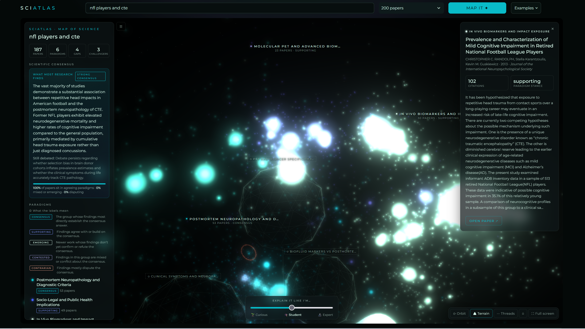

# SciAtlas: The Shape of Science

SciAtlas is an open-source research exploration platform that transforms flat, linear paper searches into an interactive 3D galaxy of scientific knowledge. By retrieving research literature, computing 768-dimensional semantic embeddings, and conducting high-dimensional vector math, SciAtlas maps scientific consensus, identifies emerging counterarguments, and mathematically reveals unexplored literature gaps.

---



---

## Why SciAtlas?

Human knowledge is dynamic, multi-dimensional, and deeply interconnected. However, online research infrastructure has remained essentially flat for three decades: search bars, walls of blue links, endless browser tabs, and dense abstracts filled with domain jargon. 

When searching for answers in complex domains, researchers face critical hurdles:
* **Information Overload:** Skimming dozens of papers to find where the field actually lands on a question.
* **Echo Chambers:** Missing vital counterarguments or niche studies that challenge established consensus.
* **Invisible Unknowns:** Traditional search engines only index what *exists*—they cannot show where research is *missing*.

SciAtlas replaces endless searching and scrolling with a single, high-density interface. It treats scientific domains as spatial networks where distance represents semantic similarity, node brightness represents impact, and voids represent unexplored frontiers.

---

## What It Does

SciAtlas ingests query-relevant research papers (via OpenAlex) and dynamically generates a 3D force-directed knowledge map alongside structural analytics:

* **Interactive 3D Galaxy Map:**
  * **Stars (Papers):** Node size scales with citation count. Node brightness scales with neighborhood density—dense paradigms blaze like galaxy cores, while isolated studies remain dim.
  * **Distance:** Proximity between stars reflects semantic similarity in high-dimensional embedding space.
* **Scientific Consensus Engine:** Calculates and presents a direct, synthesized answer to the query representing the majority finding across indexed papers, complete with a strength rating and distribution of agreeing vs. disputing work.
* **Stance & Challenger Identification:** Categorizes paradigms into stances (*Consensus*, *Supporting*, *Emerging*, *Contested*, *Contrarian*). Individual studies contradicting the primary consensus are highlighted with glowing red rings and itemized explanations.
* **True Vector Literature Gaps:** Identifies missing links in human knowledge represented as dark wireframe spheres in 3D space and corresponding terrain craters.
* **3-Level Adaptive Summaries:** An integrated *"Explain Like I'm..."* lens instantly adjusts all answers, cluster labels, and paper summaries across three reading levels: **Curious**, **Student**, and **Expert**.
* **Immersive View:** Full-window responsive UI with offline zero-CDN rendering and full-screen controls (**F** or **⛶ Full Screen**).

---

## Architecture & Pipeline

The backend executes a multi-stage parallel pipeline converting unstructured paper metadata into clustered, gap-analyzed 3D graph payloads.

```
OpenAlex API ─► SPECTER2 (768-D) ─┬─► UMAP 3D Layout ───────────────────────────────┐
                                   │                                                ├─► 3D Payload (JSON/HTML)
                                   └─► K-Means Paradigms ─► Gap Analysis ─► Gemini ─┘
```

| Pipeline Stage | Process Description | Latency Profile (200 Papers) |
| :--- | :--- | :--- |
| **Data Ingestion** | Query OpenAlex API for relevance-ranked papers with abstracts | ~2.0 s |
| **Vector Embedding** | SPECTER2 model generates 768-D embeddings from `title + abstract` (int8 quantized) | ~8.0 s cold / ~0 s cached |
| **Paradigm Clustering** | K-Means clustering (K optimized via Silhouette score) + TF-IDF keyword extraction | ~1.0 s |
| **Dimensionality Reduction** | UMAP 3D spatial projection (executed in parallel with clustering) | ~0.3 s |
| **LLM Synthesis** | Single-pass Gemini request generating consensus, stances, and 3-level summaries | ~5.0–15.0 s |

---

## Technical Deep Dive & Engineering Decisions

### 1. Mathematical Literature Gap Detection (768-D vs. 3D Space)
Dimensionality reduction algorithms like UMAP inherently distort distances and introduce visual artifacts. Calculating "gaps" in visual 3D coordinates yields arbitrary results. 

SciAtlas computes literature gaps strictly inside the original **768-dimensional SPECTER2 embedding space** prior to visualization:

1. **Centroid Traversal:** For each paradigm cluster and its nearest neighboring centroids, SciAtlas computes a normalized linear trajectory between their 768-D centroids.
2. **Probing Neighborhood Density:** It evaluates 21 discrete probe points along the trajectory, measuring the 5-Nearest Neighbor ($5$-NN) radius using cosine distance.
3. **Reference Benchmarking:** Probe measurements are compared against reference densities at the cluster centroids (the "hilltops"). To ensure mathematical validity, comparison vectors are probed against probe points rather than averaged cluster vectors.
4. **Sparsity & Density Calculation:**
   $$\text{Sparsity} = \frac{\text{Radius}_{\text{probe}}}{\text{Radius}_{\text{hilltop}}}$$
   Bridges exhibiting a sparsity threshold greater than $1.05\times$ relative to the surrounding clusters are classified as true research gaps.
5. **Spatial Projection:** Only after mathematical verification in 768-D space is the gap projected into 3D coordinates for visual rendering (drawn as wireframe spheres and terrain depressions).

### 2. High-Performance Latency Engineering
* **Quantization & Threading Optimization:** SPECTER2 runs using `int8` quantization on CPU with length-sorted batch processing. To resolve severe CPU thread contention between PyTorch's OpenMP pool and Numba JIT (which caused $8\times$ performance degradation on initial runs), `NUMBA_THREADING_LAYER` is explicitly configured to `workqueue`.
* **Parallel Execution:** UMAP layout generation and 768-D K-Means gap analysis execute concurrently on separate threads while the Gemini payload is prepared.
* **Offline Bundling:** Front-end components (`three.js`, `3d-force-graph`, `UnrealBloomPass`, Montserrat fonts) are fully bundled and inlined locally under `static/`. The UI makes zero CDN network calls during runtime.
* **Deterministic Layouts & Caching:** Computed node coordinates are fixed post-UMAP, avoiding client-side physics engine overhead. Completed map outputs and vector embeddings are cached locally in `.atlas_cache/`.

### 3. Resilient LLM Workflow
* **Single-Pass Prompting:** All text generation (consensus synthesis, contradiction reasoning, paradigm labeling across Curious/Student/Expert tiers) is consolidated into a single structured Gemini API request.
* **Rate-Limit Handling:** Requests are serialized. Rate limit errors (`429`) trigger backoff retries only if requested retry delays are $\le 20\text{ s}$. Unrecoverable API states gracefully fall back to local TF-IDF paradigm summaries without breaking map rendering.

---

## Repository Structure

```
.
├── app.py                  # Streamlit interface (landing page, map viewer, controls)
├── atlas_core.py           # Core pipeline (OpenAlex, SPECTER2, UMAP, K-Means, Gaps, Gemini)
├── map_template.html       # WebGL 3D canvas template (Three.js, force-graph, side panels)
├── precompute.py           # Batch processing utility for pre-caching demo topics
├── check_gemini.py         # System diagnostic script for LLM API status
├── static/
│   ├── atlas_vendor.js     # Bundled WebGL libraries (Three.js, 3d-force-graph)
│   └── fonts/              # Offline font assets
└── .atlas_cache/           # Local cache for paper embeddings and computed maps (git-ignored)
```

---

## Getting Started

### Prerequisites
* **Python:** 3.10 or higher
* **API Key:** Google Gemini API Key ([Get an API key here](https://aistudio.google.com/))

### Installation

1. **Clone the repository:**
   ```bash
   git clone [https://github.com/your-username/SciAtlas.git](https://github.com/your-username/SciAtlas.git)
   cd SciAtlas
   ```

2. **Create and activate a virtual environment:**
   ```bash
   python3 -m venv venv
   source venv/bin/activate  # On Windows: venv\Scripts\activate
   ```

3. **Install dependencies:**
   ```bash
   pip install -r requirements.txt
   ```

4. **Configure environment variables:**
   Set your Gemini API key in your terminal environment:
   ```bash
   export GEMINI_API_KEY="your_api_key_here"  # On Windows CMD: set GEMINI_API_KEY="your_api_key_here"
   ```

### Running the Application

1. **Start the Streamlit application:**
   ```bash
   streamlit run app.py
   ```
2. Open your browser and navigate to `http://localhost:8501`.

### Precomputing Maps (Optional)
To pre-cache complex queries prior to live demonstrations or presentations:
```bash
python precompute.py --query "NFL players and CTE"
```

---

## License

Distributed under the MIT License. See `LICENSE` for more information. Font assets (`Montserrat`) are licensed under the SIL Open Font License.
